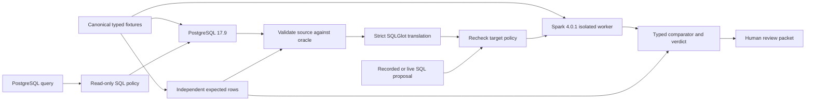

# Architecture

## Data and comparator

- The source database and Spark load the same canonical fixture values through separate adapters. The fixture contains ZAR and USD, explicit decimal amounts, duplicate settlements, and date and timestamp boundaries in Johannesburg and New York.
- The committed base answers were calculated by hand. A small Python oracle calculates expected rows for the two fixture variants from the underlying data and business rules. It does its own sorting, grouping and arithmetic independently of the SQL.
- The case contract specifies field names, order, logical types and where nulls are permitted. The comparator checks the schema even for an empty result and encodes null separately from text. The exact decimal path rejects floats and values that require rounding during comparison.
- A keyed comparison enforces non-null unique keys. A bag comparison counts full rows, including duplicates. An ordered comparison retains the engine's result sequence and requires the declared sort and tie-break at the SQL boundary.

## Isolation and approval

- PostgreSQL grants the verifier a read-only fixture role and fixes search path, UTC and statement timeout. The seeding credentials are used by bootstrap.
- Spark runs as an unprivileged user with no network or host mounts. It accepts typed records and one query per JSON Lines request. Each request creates a fresh Spark SQL session. CPU, memory, temporary storage, process count and returned rows are bounded.
- The repair adapter receives the source, the current proposed SQL, the scoped catalog and the repair fixture diagnostics. It can return SQL or abstain. The same policy and data checks apply to every suggestion. Evaluation variants are read after candidate selection.
- Verification applies to the named fixtures and engine settings. Schema deployment, cutover and production adoption belong to the reviewer. The report includes the proposed SQL diff and the checks to reproduce it.

## With more time

- Add fixture variants with nullable join keys in more relations and scale boundaries for higher-precision settlements.
- Extend the parser policy case by case as new dialect features are needed. Before adding a function or expression, add a positive case and a representative bad candidate.
- Measure live repairs with repeated trials and independent cases. The recorded repair proves that the same checks apply to a proposed patch.
